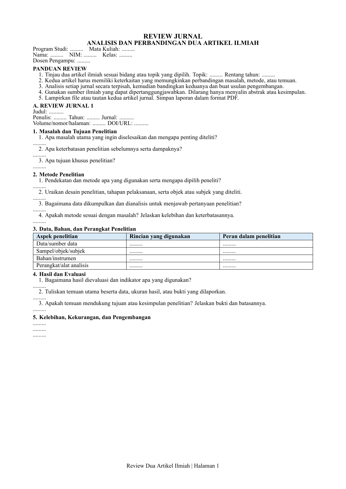

# Template Review Dua Artikel Ilmiah

Template LaTeX untuk analisis dan perbandingan dua artikel ilmiah lintas bidang. Seluruh isian identitas, jawaban, dan data artikel ditandai dengan titik-titik (`.........`). Template kosong tersusun empat halaman, dengan empat tabel, kepala tabel berwarna biru muda, footer nomor halaman, dan rubrik penilaian.

Judul dokumen adalah "REVIEW JURNAL" dengan subjudul "ANALISIS DAN PERBANDINGAN DUA ARTIKEL ILMIAH". Program studi, mata kuliah, topik, dan rentang tahun dapat diisi sendiri. Pertanyaan mencakup masalah, metode, data/bahan/perangkat, hasil, perbandingan, research gap, serta usulan pengembangan.

Format halaman dan bobot rubrik adalah contoh, bukan ketentuan universal. Sesuaikan dengan kebutuhan atau panduan institusi. Jika suatu aspek tidak relevan, tulis "tidak relevan" beserta alasannya; jika artikel tidak menjelaskannya, tulis "tidak dijelaskan".

## Pratinjau



Pratinjau halaman pertama dari empat halaman template kosong.

## Persiapan

Cara yang didukung skrip proyek ini menggunakan Windows dan PowerShell. Siapkan:

- Distribusi LaTeX yang menyediakan **XeLaTeX**, misalnya MiKTeX atau TeX Live, beserta paket yang dipakai dokumen.
- Font **Times New Roman**.
- Editor teks, misalnya VS Code. Ekstensi LaTeX bersifat opsional; kompilasi dapat dijalankan dari terminal.

Unduh atau clone repositori, lalu buka folder proyek. Di VS Code, pilih **Terminal > New Terminal**, gunakan PowerShell, dan pastikan terminal berada di folder yang memuat `Compile-Tugas.ps1`.

Periksa ketersediaan compiler:

```powershell
Get-Command xelatex
```

## Mulai cepat: melihat template kosong

Jalankan dari folder proyek:

```powershell
.\Compile-Tugas.ps1 -Open
```

Skrip menjalankan XeLaTeX dua kali, membuat PDF di folder utama, dan membukanya setelah kompilasi berhasil. Tanpa `-Open`, PDF tetap dibuat tetapi tidak otomatis dibuka.

Nama hasil bawaan:

```text
ReviewJurnal_NIM_Nama_Mahasiswa.pdf
```

Tombol Run di editor tidak diperlukan.

## Mengisi laporan

Gunakan salinan pribadi untuk mengisi laporan. Biarkan versi template publik tetap berisi titik-titik.

### 1. Isi identitas

Buka `identitas.tex`, kemudian ganti titik-titik di dalam kurung kurawal terakhir. Contoh:

```latex
\newcommand{\NamaMahasiswa}{Nama Anda}
\newcommand{\NIMMahasiswa}{NIM Anda}
\newcommand{\KelasMahasiswa}{Kelas Anda}
\newcommand{\DosenPengampu}{Nama Dosen}
\newcommand{\ProgramStudi}{Program Studi Anda}
\newcommand{\MataKuliah}{Mata Kuliah Anda}
```

Pertahankan nama perintah dan kurung kurawal `{ }`. NIDN dosen diisi terpisah pada bagian akhir `isi/pengembangan-kesimpulan.tex`. Identitas akademik dan bagian tanda tangan dapat disesuaikan dengan konteks penggunaan. Isi topik dan rentang tahun pada `isi/pembuka.tex`.

### 2. Isi review dan analisis

| Berkas | Bagian yang diisi |
| --- | --- |
| `isi/jurnal-1.tex` | Identitas artikel pertama, review, dan tabel data, bahan, dan perangkat |
| `isi/jurnal-2.tex` | Identitas artikel kedua, review, dan tabel data, bahan, dan perangkat |
| `isi/perbandingan-gap.tex` | Tabel perbandingan, analisis kritis, dan research gap |
| `isi/pengembangan-kesimpulan.tex` | Usulan pengembangan, kesimpulan, daftar pustaka, dan NIDN |

Ganti titik-titik dengan jawaban tanpa menghapus pertanyaan. Misalnya:

```latex
\teksword{8.5}{0}{.........}
```

menjadi:

```latex
\teksword{8.5}{0}{Tulis analisis Anda berdasarkan artikel yang ditinjau.}
```

Pada tabel, ganti titik-titik di dalam sel. Pertahankan pemisah kolom `&`, akhir baris `\\`, dan `\hline`. Pertahankan empat tabel serta rubrik penilaian.

Gunakan karakter khusus LaTeX dengan benar:

| Karakter dalam teks | Kode LaTeX |
| --- | --- |
| `&` | `\&` |
| `%` | `\%` |
| `_` | `\_` |

Tulis tautan dengan `\url{https://alamat-sumber}`. Angka `[1]` dan `[2]` pada daftar pustaka adalah nomor referensi. Isi referensinya dan tambahkan sitasi pada jawaban yang memakai sumber tersebut; penomoran pada template ini ditulis manual.

Jangan mengarang DOI, metode, data, atau angka hasil. Bedakan hasil artikel, hasil hitung ulang, analisis sendiri, dan target usulan penelitian. Artikel jurnal dan dokumen acuan Word tidak disertakan dalam repositori ini; sediakan sumber yang sah dan tautan artikel sesuai kebutuhan tugas.

### 3. Simpan dan buat PDF

Simpan semua berkas yang diedit, lalu jalankan:

```powershell
.\Compile-Tugas.ps1 -NIM NIM_Anda -Nama Nama_Anda -Open
```

Ganti `NIM_Anda` dan `Nama_Anda` dengan isian untuk **nama berkas PDF**. Argumen hanya menerima huruf A-Z/a-z, angka, tanda hubung (`-`), atau garis bawah (`_`). Gunakan garis bawah untuk menggantikan spasi pada nama.

Nama hasil mengikuti pola:

```text
ReviewJurnal_NIM_Anda_Nama_Anda.pdf
```

Argumen `-NIM` dan `-Nama` tidak mengubah identitas di dalam dokumen. Identitas laporan tetap dibaca dari `identitas.tex`. Menjalankan skrip dengan nama hasil yang sama memperbarui PDF tersebut; mengganti argumen dapat menghasilkan PDF lain.

### 4. Periksa hasil akhir

Buka PDF hasil skrip di folder utama dan periksa identitas, sitasi, tabel, serta teks yang terpotong atau melampaui margin. Template kosong memiliki empat halaman; setelah jawaban diisi, jumlah halaman dapat bertambah. Empat halaman adalah contoh panjang awal; sesuaikan panjang akhir dengan kebutuhan. Ketentuan format dan contoh rubrik berada di `isi/pengembangan-kesimpulan.tex`. Jika mengubah bobot rubrik, pastikan totalnya 100%.

Pengaturan bawaan di `pengaturan.tex` adalah `\TampilanWordfalse`: A4, margin 2 cm, Times New Roman, dan ukuran huruf dibatasi 10-12 pt. Mode `\TampilanWordtrue` mengikuti ukuran Word asal, termasuk Letter dan sebagian ukuran huruf di bawah 10 pt; gunakan pengaturan bawaan sebagai titik awal dan sesuaikan bila diperlukan.

## Struktur proyek

```text
review-jurnal.tex                 # Dokumen utama, gaya, footer, dan urutan bagian
identitas.tex                     # Identitas mahasiswa, dosen, prodi, dan mata kuliah
pengaturan.tex                    # Pilihan tampilan
isi/
  pembuka.tex                     # Judul, identitas, topik, tahun, dan panduan review
  jurnal-1.tex                    # Review artikel pertama dan tabel sumber/perangkat
  jurnal-2.tex                    # Review artikel kedua dan tabel sumber/perangkat
  perbandingan-gap.tex            # Tabel perbandingan, analisis, dan research gap
  pengembangan-kesimpulan.tex     # Usulan, kesimpulan, referensi, format, dan rubrik
Compile-Tugas.ps1                 # Skrip kompilasi PowerShell
.gitignore                       # Pengecualian hasil build dan dokumen lokal
AGENTS.md                        # Petunjuk pemeliharaan untuk agen
README.md                        # Panduan penggunaan
docs/preview.png                 # Pratinjau halaman pertama untuk README
```

PDF hasil kompilasi dibuat langsung di folder utama. Berkas sementara dan log berada di `tmp/build/tugas-review-jurnal/`. Folder ini dibuat otomatis saat kompilasi dan tidak perlu tersedia setelah clone.

## Jika kompilasi bermasalah

| Gejala | Langkah pemeriksaan |
| --- | --- |
| `xelatex` tidak ditemukan | Pastikan distribusi LaTeX terpasang dan folder executable tersedia di PATH; buka ulang terminal setelah pemasangan. |
| Font tidak ditemukan | Periksa ketersediaan Times New Roman di komputer. |
| Paket LaTeX tidak ditemukan | Pasang paket yang disebut pada pesan kesalahan melalui pengelola paket distribusi LaTeX. |
| PowerShell menolak menjalankan skrip | Periksa kebijakan skrip pada perangkat. Alternatif kompilasi langsung tersedia di bawah. |
| PDF tidak bisa diperbarui | Tutup PDF yang sedang terbuka, kemudian jalankan skrip lagi. Hasil build tetap tersedia di folder sementara. |
| Kompilasi gagal setelah mengedit | Periksa kurung kurawal, karakter khusus, dan pemisah tabel; baca `tmp/build/tugas-review-jurnal/review-jurnal.log`. |
| PDF yang dibuka belum berubah | Simpan berkas sumber, kompilasi ulang, lalu buka PDF dengan nama hasil yang ditampilkan terminal. |

Alternatif kompilasi langsung dari folder proyek jika skrip PowerShell tidak dapat digunakan:

```powershell
New-Item -ItemType Directory -Force -Path tmp/build/tugas-review-jurnal | Out-Null
xelatex -interaction=nonstopmode -halt-on-error -file-line-error -output-directory=tmp/build/tugas-review-jurnal review-jurnal.tex
xelatex -interaction=nonstopmode -halt-on-error -file-line-error -output-directory=tmp/build/tugas-review-jurnal review-jurnal.tex
```

Jalankan XeLaTeX untuk kedua kalinya hanya jika proses XeLaTeX pertama berhasil. Dengan cara langsung ini, PDF berada di `tmp/build/tugas-review-jurnal/review-jurnal.pdf`; tidak otomatis disalin ke folder utama atau diberi nama berdasarkan identitas.

## Menjaga template publik

Sebelum commit atau push, periksa:

```powershell
git status --short
git diff
git diff --cached
git ls-files
```

Pastikan isian identitas dan jawaban tetap berupa titik-titik. PDF, Word, folder `tmp/`, dan berkas sementara LaTeX diabaikan oleh `.gitignore`; jangan memaksakan penambahannya dengan `git add -f`. Berkas `.tex` tetap dilacak Git, sehingga identitas yang dimasukkan ke dalamnya dapat ikut terunggah jika di-commit.

Menghapus data dari berkas sekarang tidak menghapusnya dari commit lama. Periksa juga riwayat sebelum membagikan repositori. Nama akun GitHub pemilik repositori tetap terlihat.

## Penyesuaian lintas bidang

Dua tabel review memuat data/sumber data, sampel/objek/subjek, bahan/instrumen, serta perangkat/alat analisis. Gunakan istilah dan bukti yang sesuai bidang penelitian; perangkat fisik tidak wajib ada. Tabel ketiga membandingkan kedua artikel, dan tabel keempat merupakan contoh rubrik penilaian.

Nama skrip `Compile-Tugas.ps1` dan folder sementara `tmp/build/tugas-review-jurnal/` dipertahankan agar perintah penggunaan tetap kompatibel. Nama PDF hasil skrip kini memakai pola umum `ReviewJurnal_NIM_Nama.pdf`. PDF lokal dari versi terdahulu tidak diperbarui oleh nama keluaran baru; gunakan jalur PDF yang ditampilkan terminal setelah build.
